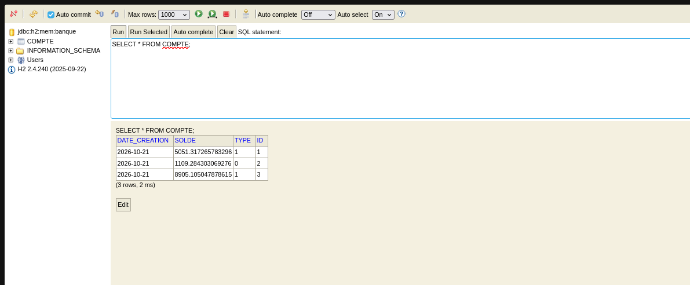
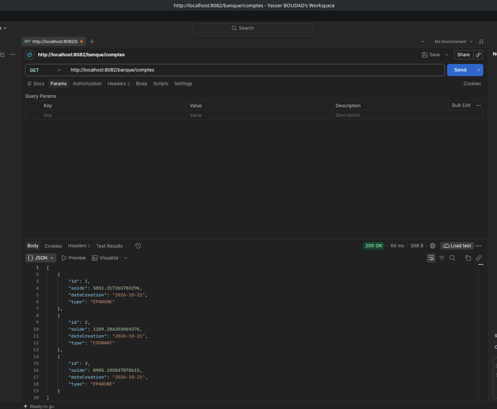
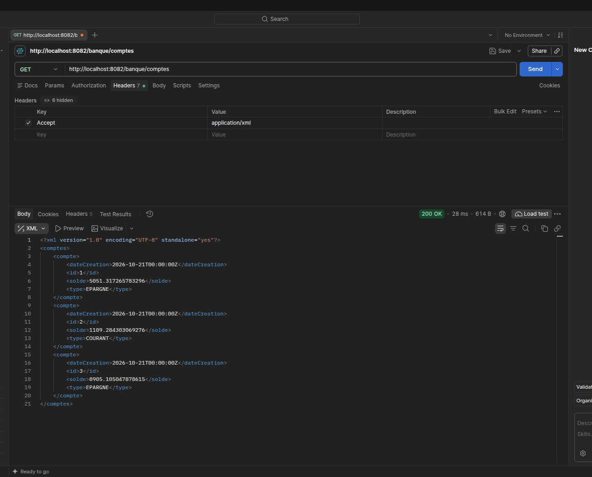
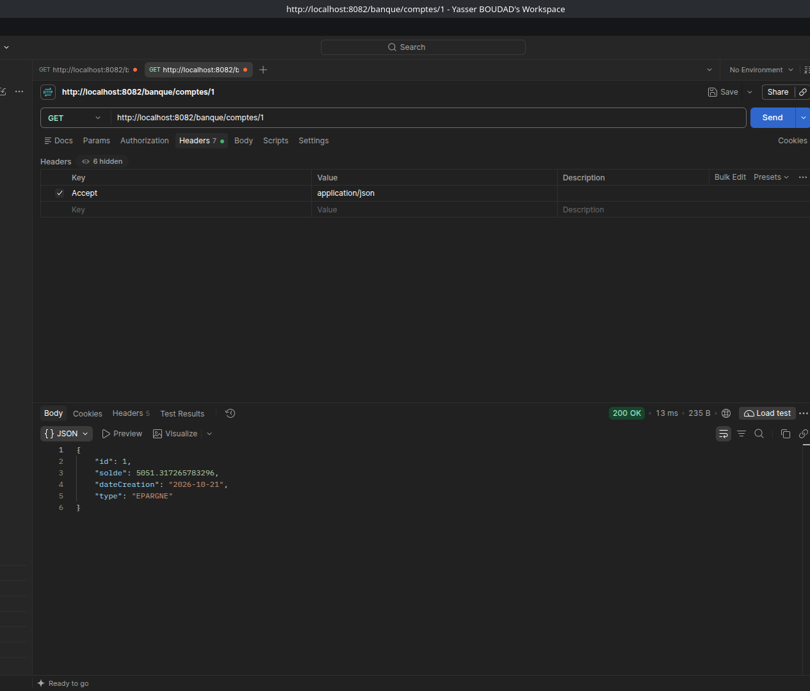
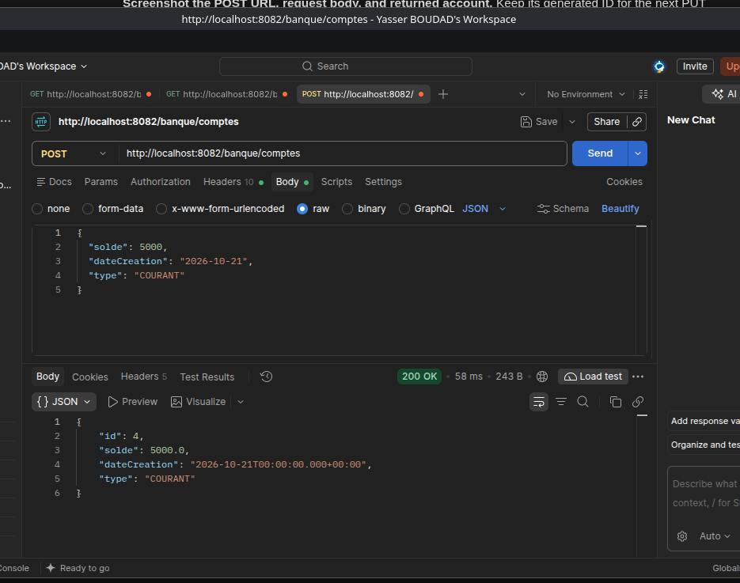
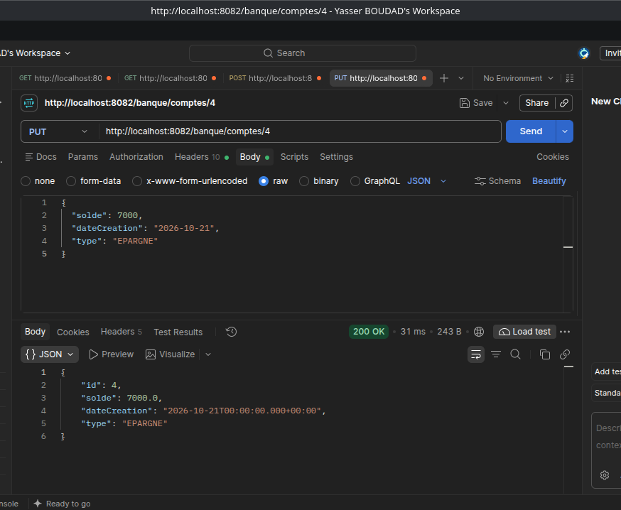
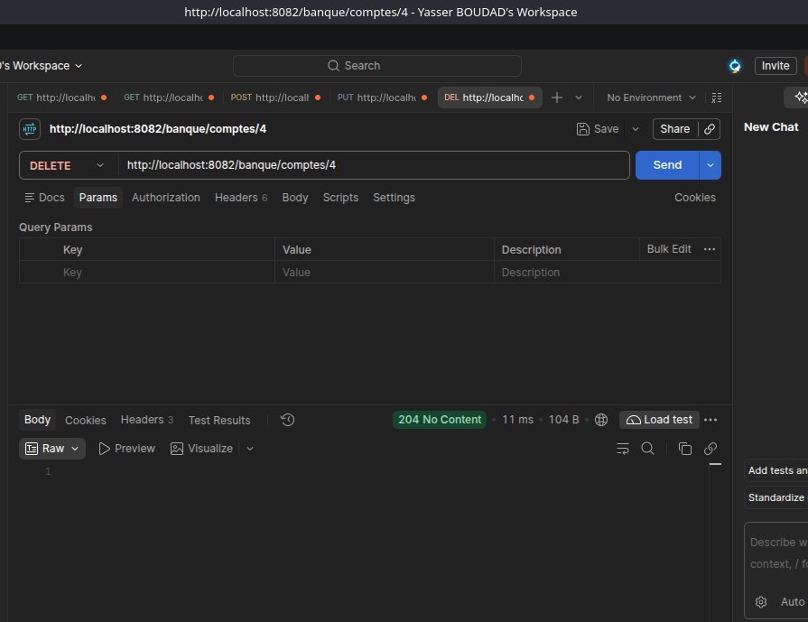
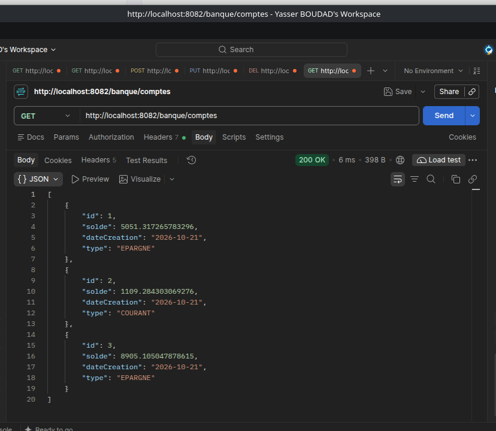

# TP7 : JAX-RS / Jersey

## 1. Lancement de l'application

Nous avons lancé `Application` dans IntelliJ avec Java 25. Le projet utilise Maven, Spring Boot et Jersey pour exposer les services REST sur le port `8082`. Au démarrage, trois comptes sont créés dans la base H2 en mémoire `banque` : EPARGNE, COURANT et EPARGNE, avec des soldes aléatoires.

## 2. Vérification de la base H2

Nous avons ouvert `http://localhost:8082/h2-console/` avec l'URL JDBC `jdbc:h2:mem:banque`, l'utilisateur `sa` et un mot de passe vide. La requête `SELECT * FROM COMPTE;` affiche les trois comptes avec leurs identifiants, dates de création, soldes et types. Les valeurs `0` et `1` correspondent à COURANT et EPARGNE, car l'entité utilise `EnumType.ORDINAL`.

## 3. Tests de l'API avec Postman

### Liste des comptes en JSON

La requête `GET /banque/comptes` retourne `200 OK` et la liste des trois comptes au format JSON. Les données correspondent aux comptes présents dans H2.

### Liste des comptes en XML

Nous avons envoyé la même requête avec l'en-tête `Accept: application/xml`. La réponse `200 OK` contient les trois comptes sous l'élément racine `<comptes>`. Chaque compte est représenté par un élément `<compte>`.

### Recherche d'un compte par son identifiant

La requête `GET /banque/comptes/1`, avec `Accept: application/json`, retourne `200 OK` et un seul compte. Son identifiant est `1` et son type est EPARGNE.

### Ajout d'un compte

Nous avons envoyé `POST /banque/comptes` avec un corps JSON contenant le solde `5000`, la date de création `2026-10-21` et le type COURANT. La réponse `200 OK` retourne le compte créé avec l'identifiant généré `4`.

### Modification d'un compte

Nous avons envoyé `PUT /banque/comptes/4` avec un solde de `7000` et le type EPARGNE. La réponse `200 OK` affiche les nouvelles valeurs, en conservant l'identifiant `4`.

### Suppression d'un compte

La requête `DELETE /banque/comptes/4` retourne `204 No Content`, avec un corps vide.

### Vérification après suppression

Nous avons renvoyé `GET /banque/comptes`. La réponse `200 OK` contient uniquement les comptes `1`, `2` et `3`. L'absence du compte `4` confirme sa suppression.
